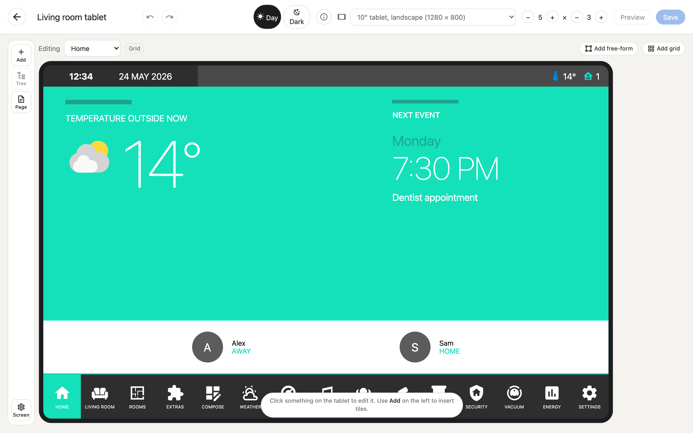
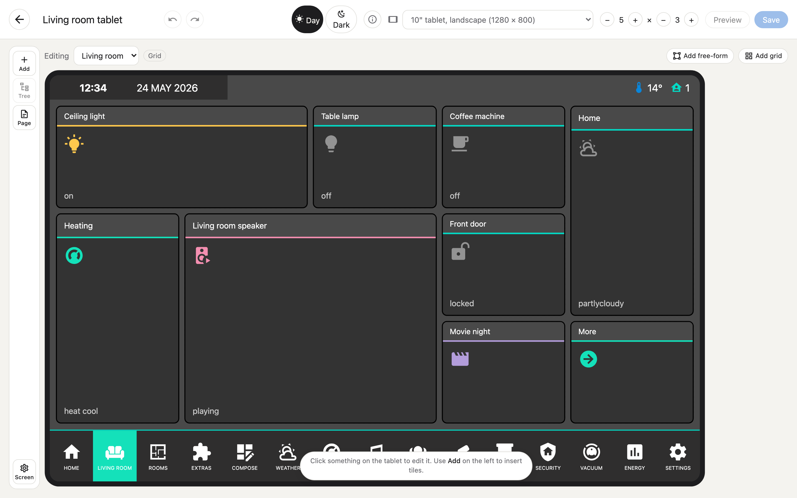
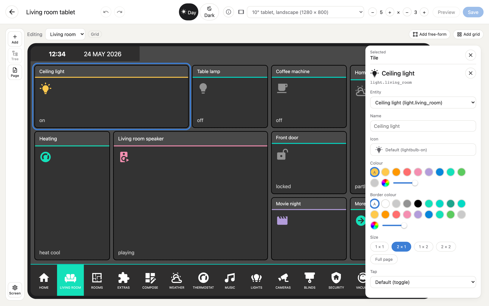
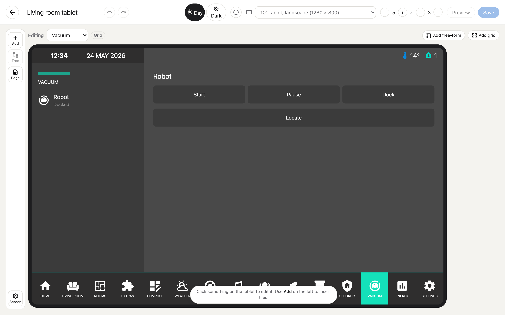
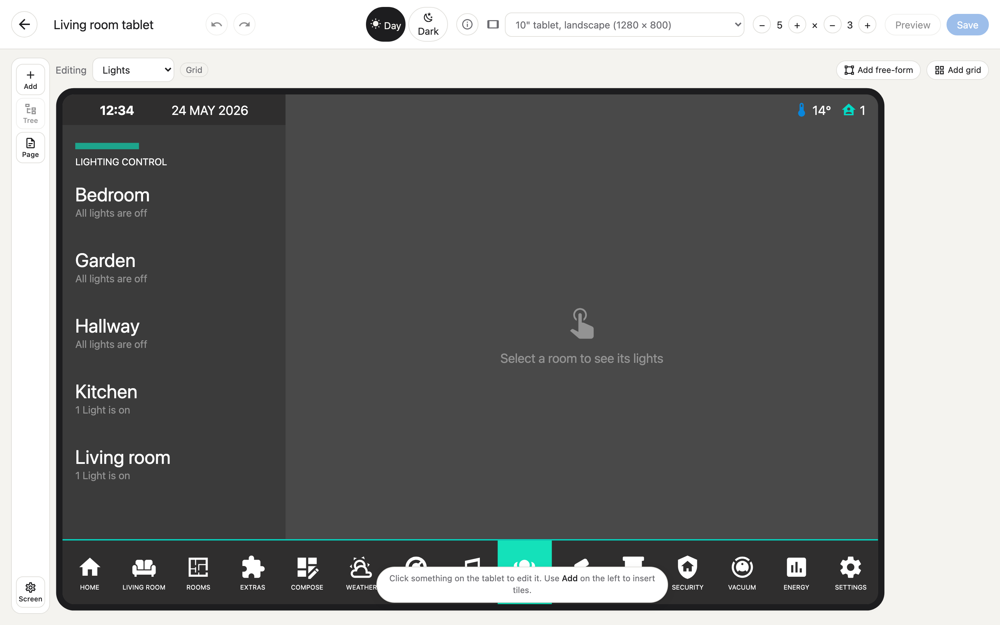
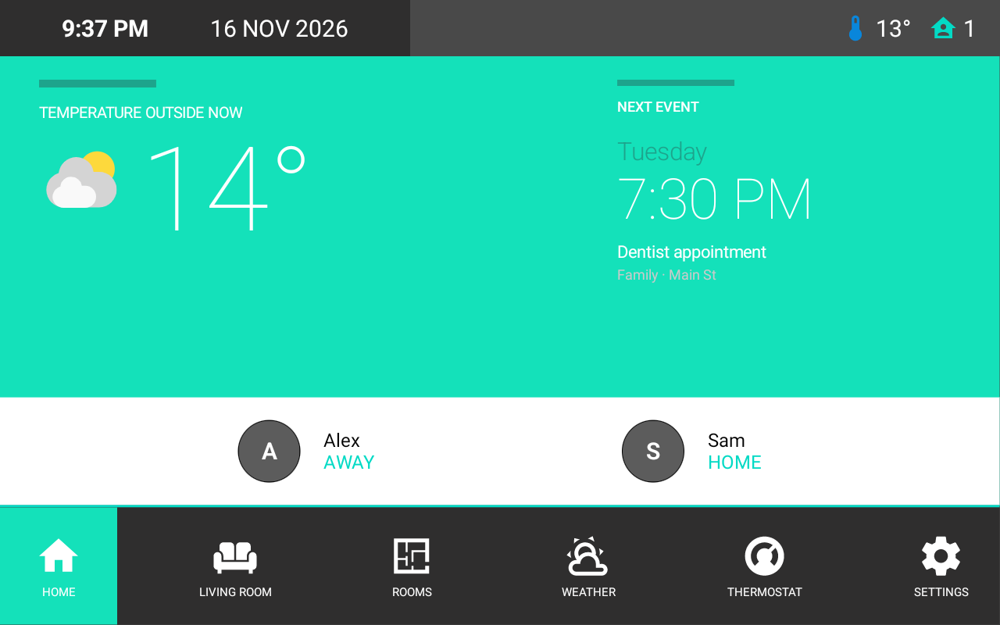
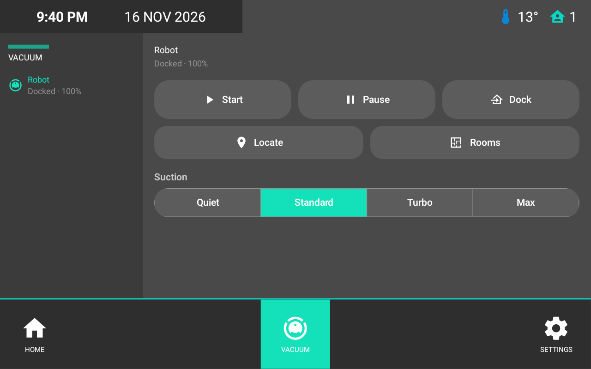
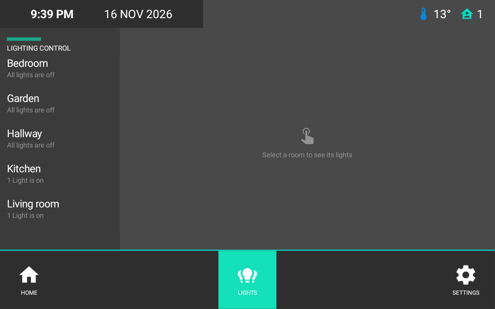
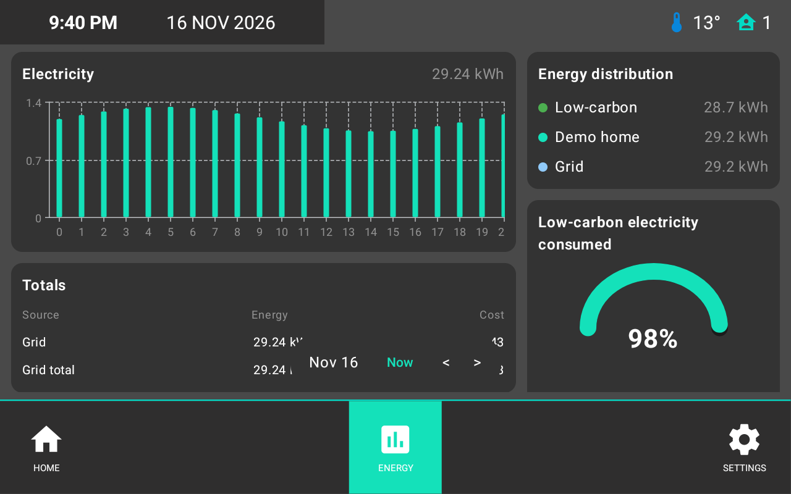
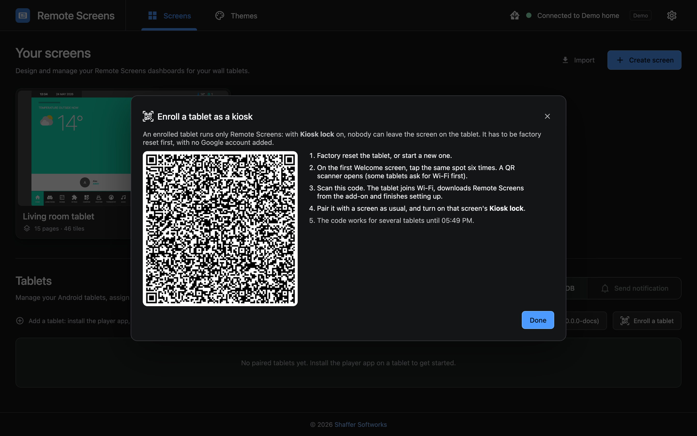

# Remote Screens

Home Assistant wall screens on Android tablets, drawn with
[Remote Compose](https://developer.android.com/jetpack/androidx/releases/compose-remote).

A Home Assistant add-on lays out screens of tiles (or free-form Compose pages), draws each one as a Remote Compose
document and streams it to tablets running a small player app. Live state goes to the tablets as updates to
variables in the document, so a state change never sends the screen again. Taps go back to the add-on, which calls
Home Assistant; the tablets hold no Home Assistant token.

Screens wear a theme (built-in or made in the editor) by day and another in dark mode and at night. Tablets can
wake from standby via Home Assistant, proximity or face detection; the top bar can show Wi‑Fi and battery.

Full guide: [GitHub Wiki](https://github.com/Shaffer-Softworks/remote-screens/wiki). How to pair and lay out a
screen is also in [addon/DOCS.md](addon/DOCS.md).

## Screenshots

The editor, opened through ingress, with the made-up [demo home](docs/DEMO.md):



| | |
| --- | --- |
|  |  |
| Lay out tiles on a grid, page by page | Pick a tile's entity, icon, colours, size and actions |
|  |  |
| Vacuum panel | Lights panel |

On the tablet (demo home):

| | |
| --- | --- |
|  |  |
| Home page | Vacuum panel |
|  |  |
| Lights panel | Energy dashboard |

More editor and player shots (blinds, security, cameras, free-form, themes, pairing) are on the
[wiki Screenshots page](https://github.com/Shaffer-Softworks/remote-screens/wiki/Screenshots).
Retake them with `tools/capture_screenshots.mjs` and the player capture flow in
[docs/SCREENSHOTS.md](docs/SCREENSHOTS.md).

## What is in this repository

| Path | What |
| ---- | ---- |
| `server/` | The add-on: a Kotlin/Ktor server that talks to Home Assistant, renders documents and serves the editor |
| `player/` | The Android player app (Android 8 and later) |
| `preview/` | Android Studio previews of server-rendered UI, using local demo data |
| `shared/` | The layout model, the grid maths and the protocol, used by the server and the player |
| `editor/` | The Vue 3 editor, opened through ingress |
| `catalogue/` | Which tiles and cards each Home Assistant domain gets |
| `custom_components/remote_screens/` | The Home Assistant integration (HACS) for screen settings and services |
| `addon/` | The add-on's packaging, documentation and changelog |
| `docker/` | Running without the Supervisor (Home Assistant Container or Core) |
| `tools/` | Packaging, catalogue codegen, screenshot capture |

## Install

1. **Add-on.** In Home Assistant, Settings, Add-ons, Add-on store, add this repository
   (`https://github.com/Shaffer-Softworks/remote-screens`) and install **Remote Screens**.
2. **Player app.** Download it from the editor (**Download app**) or from the latest GitHub release.
3. **Integration** (optional, for automations). In the editor, open **Settings** and choose **Install
   integration** (opens HACS). Or in HACS, add this repository as a custom repository of type *Integration*,
   install **Remote Screens** and restart Home Assistant. The add-on announces itself, so Home Assistant then
   offers to set it up. The editor also reminds you when the integration is not loaded yet.

How to pair a tablet and lay out a screen is in [addon/DOCS.md](addon/DOCS.md) and the
[wiki](https://github.com/Shaffer-Softworks/remote-screens/wiki). Without the Supervisor, see
[docker/compose.yaml](docker/compose.yaml).

## Notifications

Send banners and alerts from **Tablets → Send notification** or Home Assistant automations.
See [Device notifications](docs/NOTIFICATIONS.md) for targeting, actions, and delivery results.

## Intercom

Call tablets from a full-page Intercom tile, **Tablets → Intercom** in the editor, or a Home Assistant
dashboard card. Browser calls need HTTPS and microphone permission; audio needs a direct local network path.
See [Intercom](docs/INTERCOM.md) for setup and audio troubleshooting.

## Kiosk lock

A screen's **Kiosk lock** (a switch in Home Assistant, or a setting in the editor) keeps its tablet on Remote
Screens. Enrolled as a kiosk (Android's *device owner*), the tablet runs in lock task mode: no Home, Recents,
notifications or power menu. Other tablets fall back to screen pinning. A **Kiosk PIN** unlocks the tablet locally.



1. **QR code.** Factory reset the tablet, tap its Welcome screen six times and scan the code from the editor
   (**Tablets**, **Enroll a tablet**). The tablet joins Wi-Fi, downloads the app from the add-on and enrolls itself.
2. **adb**, for tablets without the QR scanner:
   `./scripts/enroll-device-owner.sh --fresh remote-screens.apk` (tablet with no accounts, USB debugging on).

[addon/DOCS.md](addon/DOCS.md#kiosk-lock) has the details: pinning, the PIN, and how to stop managing a tablet.

QR enrollment checks the APK's signing certificate. `tools/package_addon.sh` writes its checksum to `version.json`
when `apksigner` (Android SDK build tools, which need Java) is found; without it the add-on sends a checksum of the
APK file instead, which also works.

## Development

You need JDK 21, the Android SDK (for the player), the Android CLI, Node 24 and Python 3.13. See [CONTRIBUTING.md](CONTRIBUTING.md).

```sh
./gradlew :shared:test :server:test        # server and shared tests
./gradlew :server:installDist              # the server, runnable as server/build/install/server/bin/server
./gradlew :player:assembleDebug            # the player app
./gradlew :preview:assembleDebug           # Android Studio previews of server UI

cd editor && npm ci && npm test && npm run build

python -m pip install -r requirements_test.txt && python -m pytest   # the integration
```

[ADB integration](docs/ADB.md) covers Android Studio deployment tasks and wireless tablet management from the editor.
[Screen orientation](docs/ORIENTATION.md) covers the portrait and landscape lock, and large tablets that ignore it after wake.

A made-up home makes it possible to work without Home Assistant — see [docs/DEMO.md](docs/DEMO.md):

```sh
REMOTE_SCREENS_DEMO=1 REMOTE_SCREENS_DATA=/tmp/rs-demo \
REMOTE_SCREENS_STATIC=editor/dist \
REMOTE_SCREENS_INGRESS_PORT=18099 REMOTE_SCREENS_PLAYER_PORT=18100 \
server/build/install/server/bin/server
```

To hand out the player app from it, add `REMOTE_SCREENS_APK=<dir>` with a folder holding `remote-screens.apk` and a
`version.json` such as `{"versionCode": 100, "versionName": "0.1.0"}` (`tools/package_addon.sh` writes both).
The editor is then at <http://localhost:18099> (or run `npm run dev` in `editor/`, which proxies the API to it).
In the Android emulator, start the player with
`adb shell am start -n tech.shaffersoftworks.remotescreens.player/.MainActivity --es server 10.0.2.2:18100`.

The player's application ID was `dev.remotescreens.player` before; Android treats the renamed app as a different
one, so uninstall the old build first (kiosk tablets need a factory reset and a new enrollment).

[preview/README.md](preview/README.md) explains the Android Studio preview gallery for server-rendered screens,
tiles, cards, panels and free-form components. Build it with `./gradlew :preview:assembleDebug`.

[docs/REMOTE_COMPOSE.md](docs/REMOTE_COMPOSE.md) lists what we learned about Remote Compose `1.0.0-alpha24`
and the workarounds the code relies on. Architecture notes are on the
[wiki](https://github.com/Shaffer-Softworks/remote-screens/wiki/Architecture).

How to cut a release (workflow, sync PR, player signing secrets) is in
[CONTRIBUTING.md](CONTRIBUTING.md#releases).

## License

Apache License 2.0. See [LICENSE](LICENSE) and [NOTICE](NOTICE).
