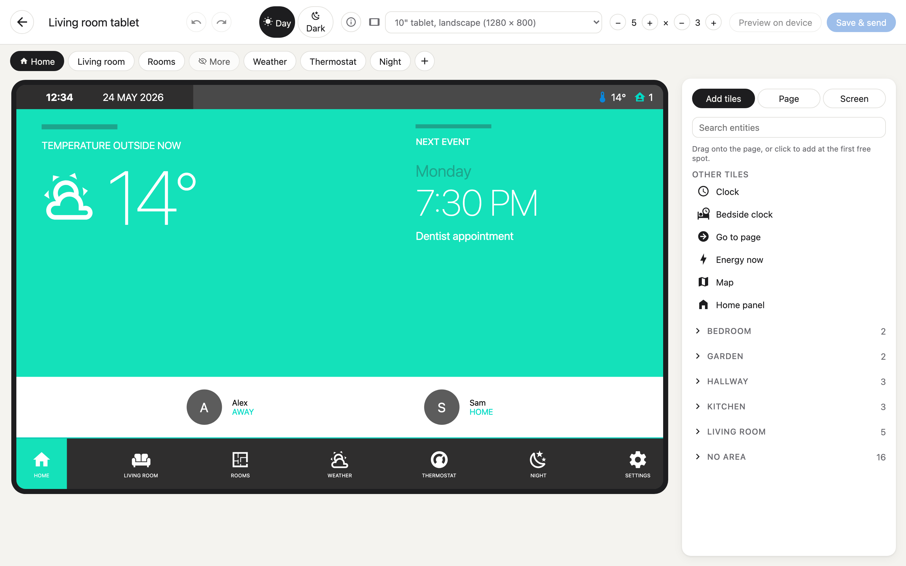
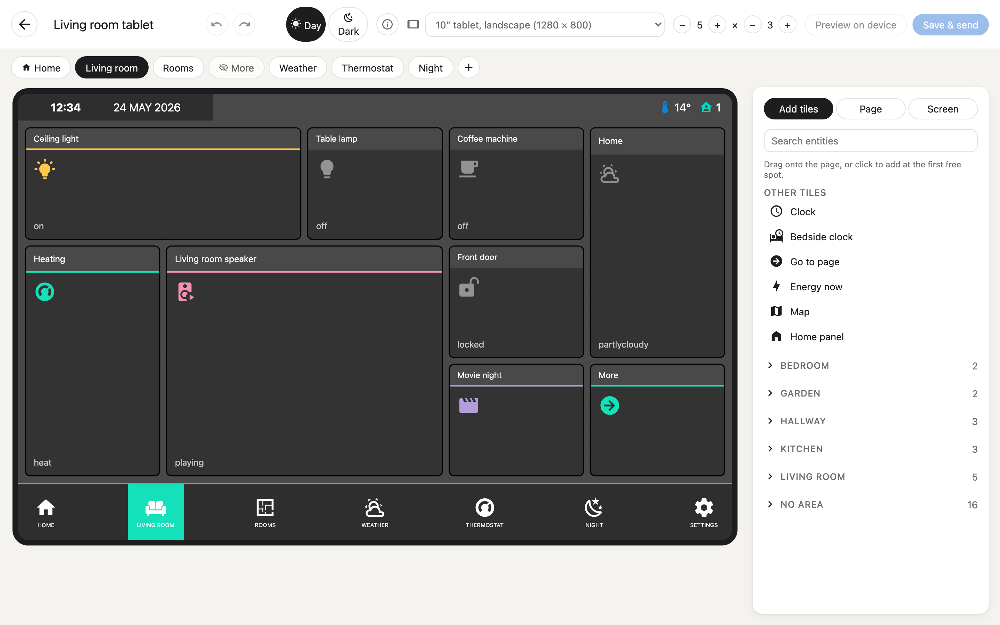
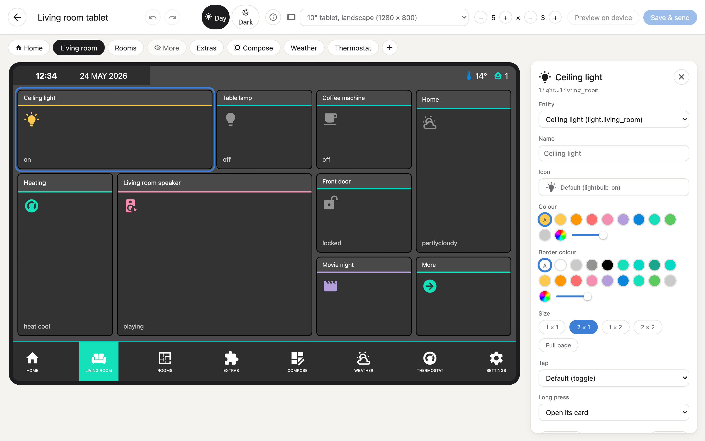
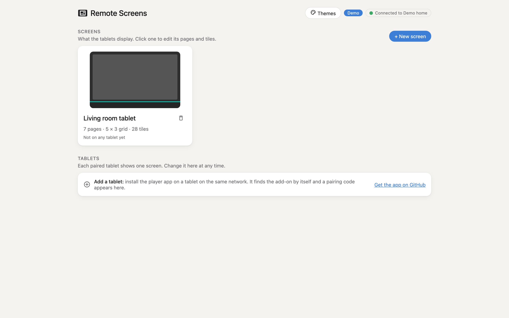
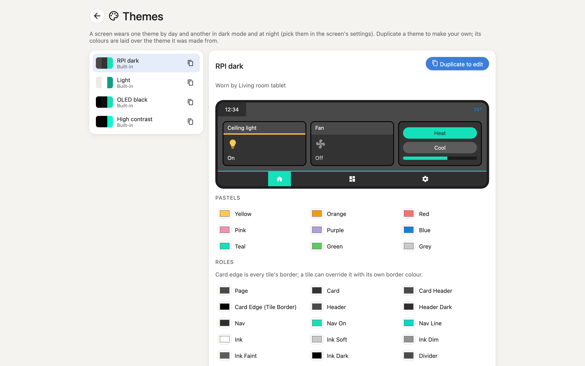
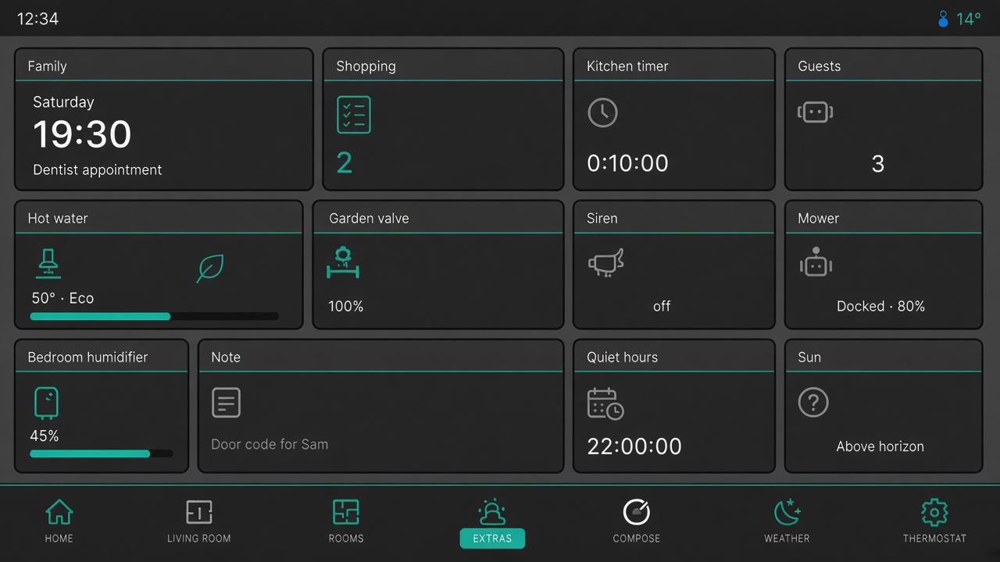
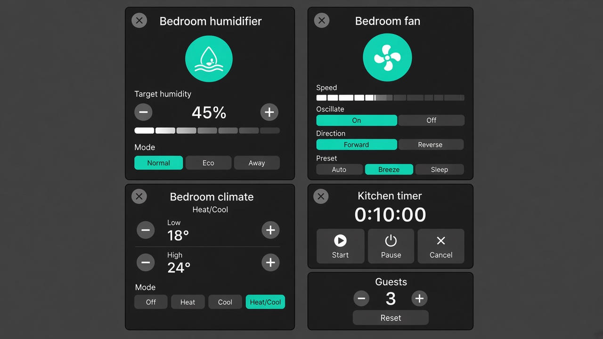
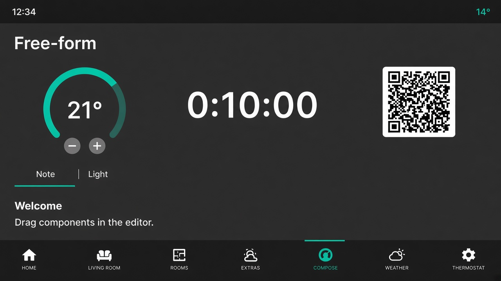

# Remote Screens

Home Assistant wall screens on Android tablets, drawn with
[Remote Compose](https://developer.android.com/jetpack/androidx/releases/compose-remote).

A Home Assistant add-on lays out screens of tiles, draws each one as a Remote Compose document and streams it to
tablets running a small player app. Live state (on/off, brightness, temperatures, now playing) goes to the tablets
as updates to variables in the document, so a state change never sends the screen again. Taps go back to the
add-on, which calls Home Assistant; the tablets hold no Home Assistant token.

Screens wear a theme (built-in or made in the editor) by day and another in dark mode and at night; the add-on
draws every colour from it (`server/.../render/Themes.kt`), and the editor previews with the same colours.

The idea follows [Tessera](https://github.com/MaxGramser/homeassistant_espscreen), which does this for ESP32
screens. No Tessera code or assets are used.

## Screenshots

The editor, opened through ingress, with the made-up demo home:



| | |
| --- | --- |
|  |  |
| Lay out tiles on a grid, page by page | Pick a tile's entity, icon, colours, size and actions |
|  |  |
| Screens and the tablets showing them | Themes, built-in or your own |

`tools/capture_screenshots.mjs` retakes them from a running demo server.

Concept mockups for the newer tiles, detail cards and free-form components, drawn to match the RPI dark theme and demo entities (not live captures):

| | |
| --- | --- |
|  |  |
| New domain tiles (calendar, todo, timer, …) | Detail cards (humidifier, fan, dual climate, timer) |
|  | |
| Free-form dial, countdown, QR, tabs and markdown | |

## What is in this repository

| Path | What |
| ---- | ---- |
| `server/` | The add-on: a Kotlin/Ktor server that talks to Home Assistant, renders documents and serves the editor |
| `player/` | The Android player app (Android 8 and later) |
| `shared/` | The layout model, the grid maths and the protocol, used by the server and the player |
| `editor/` | The Vue 3 editor, opened through ingress |
| `catalogue/` | Which tiles and cards each Home Assistant domain gets |
| `custom_components/remote_screens/` | The Home Assistant integration (HACS) for screen settings and services |
| `addon/` | The add-on's packaging, documentation and changelog |
| `docker/` | Running without the Supervisor (Home Assistant Container or Core) |

## Install

1. **Add-on.** In Home Assistant, Settings, Add-ons, Add-on store, add this repository
   (`https://github.com/sickkick/remote-screens`) and install **Remote Screens**.
2. **Player app.** Download it from the editor (**Download the player app**) or from the latest GitHub release.
3. **Integration** (optional, for automations). In HACS, add this repository as a custom repository of type
   *Integration*, install **Remote Screens** and restart Home Assistant. The add-on announces itself, so Home
   Assistant then offers to set it up.

How to pair a tablet and lay out a screen is in [addon/DOCS.md](addon/DOCS.md). Without the Supervisor, see
[docker/compose.yaml](docker/compose.yaml).

## Kiosk lock

A screen's **Kiosk lock** (a switch in Home Assistant, or a setting in the editor) keeps its tablet on Remote
Screens. Enrolled as a kiosk (Android's *device owner*), the tablet runs in lock task mode: no Home, Recents,
notifications or power menu. Other tablets fall back to screen pinning. A **Kiosk PIN** unlocks the tablet locally.

1. **QR code.** Factory reset the tablet, tap its Welcome screen six times and scan the code from the editor
   (**Tablets**, **Enroll a tablet**). The tablet joins Wi-Fi, downloads the app from the add-on and enrolls itself.
2. **adb**, for tablets without the QR scanner:
   `./scripts/enroll-device-owner.sh --fresh remote-screens.apk` (tablet with no accounts, USB debugging on).

[addon/DOCS.md](addon/DOCS.md#kiosk-lock) has the details: pinning, the PIN, and how to stop managing a tablet.

QR enrollment checks the APK's signing certificate. `tools/package_addon.sh` writes its checksum to `version.json`
when `apksigner` (Android SDK build tools, which need Java) is found; without it the add-on sends a checksum of the
APK file instead, which also works.

## Development

You need JDK 21, the Android SDK (for the player), Node 24 and Python 3.13.

```sh
./gradlew :shared:test :server:test        # server and shared tests
./gradlew :server:installDist              # the server, runnable as server/build/install/server/bin/server
./gradlew :player:assembleDebug            # the player app

cd editor && npm ci && npm test && npm run build

python -m pip install -r requirements_test.txt && python -m pytest   # the integration
```

A made-up home makes it possible to work without Home Assistant:

```sh
REMOTE_SCREENS_DEMO=1 REMOTE_SCREENS_DATA=/tmp/rs-demo \
REMOTE_SCREENS_STATIC=editor/dist \
REMOTE_SCREENS_INGRESS_PORT=18099 REMOTE_SCREENS_PLAYER_PORT=18100 \
server/build/install/server/bin/server
```

To hand out the player app from it, add `REMOTE_SCREENS_APK=<dir>` with a folder holding `remote-screens.apk` and a
`version.json` such as `{"versionCode": 100, "versionName": "0.1.0"}` (`tools/package_addon.sh` writes both).
The editor is then at <http://localhost:18099> (or run `npm run dev` in `editor/`, which proxies the API to it).
In the Android emulator, start the player with
`adb shell am start -n tech.shaffersoftworks.remotescreens.player/.MainActivity --es server 10.0.2.2:18100`.

The player's application ID was `dev.remotescreens.player` before; Android treats the renamed app as a different
one, so uninstall the old build first (kiosk tablets need a factory reset and a new enrollment).

[docs/REMOTE_COMPOSE.md](docs/REMOTE_COMPOSE.md) lists what we learned about Remote Compose `1.0.0-alpha21`
and the workarounds the code relies on.

### Releases

1. Run [the release workflow](.github/workflows/addon.yml) from **Actions → Release → Run workflow** on
   `main` and enter the new version (e.g. `0.1.14`). You do not need to bump version files first.
2. The workflow tags `v<version>` on the current `main` tip, builds the signed player app (stamping that
   version into the build), packages the add-on, pushes
   `ghcr.io/<owner>/remote-screens-{amd64,aarch64}`, and attaches the APK to the GitHub release.
3. When `main` still has an older `addon/VERSION` / `config.yaml`, it opens a sync PR so those files (and a
   changelog stub, if missing) match the tag. Merge that PR so the repo stays aligned with the published
   add-on. Optionally edit the changelog in that PR for curated notes next time.

You can still push tag `v<version>` yourself; the same build runs, and a sync PR is opened if needed.

For curated GitHub release notes, add a `## <version>` section to `addon/CHANGELOG.md` on `main` before
step 1; otherwise the release uses GitHub’s generated notes.

Tablets only accept an update signed with the key the app was first installed with, so every release must use
the same key. The workflow reads it from these repository secrets:

| Secret | What |
| ------ | ---- |
| `PLAYER_KEYSTORE_BASE64` | The keystore, base64 encoded |
| `PLAYER_KEYSTORE_PASSWORD` | Its password |
| `PLAYER_KEY_ALIAS` | The key's alias |
| `PLAYER_KEY_PASSWORD` | The key's password |

## Third-party material

See [NOTICE](NOTICE).
